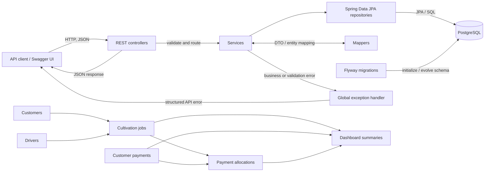

# KhetiHisab

KhetiHisab is a Spring Boot REST API for managing agricultural/tractor service
work, customers, drivers, job payments, payment allocations, and outstanding
balances. It uses PostgreSQL for persistence and provides interactive API
documentation through Swagger UI.

## Features

- Create, update, retrieve, and search customers.
- Create, update, search, activate, and deactivate drivers.
- Track cultivation jobs and their `PENDING`, `IN_PROGRESS`, `COMPLETED`, or
  `CANCELLED` status.
- Record customer payments and optionally allocate them to jobs. Allocations
  are checked against customer ownership, job status, and remaining job balance.
- View a date-filtered dashboard summary of jobs, payments, outstanding amount,
  active customers, and active drivers.
- Validate API requests and return consistent JSON error responses.
- Create and update the database schema with Flyway migrations.

## Request and data flow



For a typical request, the controller accepts the HTTP request and validated
DTO, the service applies business rules, and the repository reads or writes
the corresponding records in PostgreSQL. The controller returns a JSON DTO.
Errors are converted by the global exception handler into an `ApiError`
response.

## Technology

- Java 21
- Spring Boot 3.5
- Spring Web, Spring Data JPA, Hibernate, and Jakarta Bean Validation
- PostgreSQL 17
- Flyway
- springdoc-openapi / Swagger UI
- Maven Wrapper

## Prerequisites

- JDK 21 (and `JAVA_HOME` configured)
- Docker with Docker Compose, or a separately running PostgreSQL instance
- Ports `8080` (API) and `5432` (PostgreSQL) available, unless reconfigured

## Start locally

From the project root, start the PostgreSQL database:

```powershell
docker compose up -d
```

Then start the API in a second terminal:

```powershell
.\mvnw.cmd spring-boot:run
```

On macOS/Linux, use `./mvnw spring-boot:run` instead. On startup, Flyway runs
the migrations in `src/main/resources/db/migration`, and Hibernate validates
the schema. The API listens on port `8080` by default.

To stop the database container:

```powershell
docker compose down
```

To also delete the local database volume and its data, run
`docker compose down -v`.

## Configuration

Application settings can be overridden with environment variables:

| Variable | Default | Description |
|---|---|---|
| `APP_NAME` | `KhetiHisab` | Spring application name |
| `SERVER_PORT` | `8080` | HTTP port for the API |
| `DB_URL` | `jdbc:postgresql://localhost:5432/khetihisab` | JDBC URL |
| `DB_USERNAME` | `postgres` | PostgreSQL username |
| `DB_PASSWORD` | `postgres` | PostgreSQL password |

The Docker Compose database uses the same local database name and credentials.
These defaults are for local development; configure appropriate credentials
for any shared or production environment.

## API and Swagger

All application endpoints are under `/api/v1`.

| Resource | Endpoints | Purpose |
|---|---|---|
| Customers | `POST /customers`<br>`PUT /customers/{customerId}`<br>`GET /customers/{customerId}`<br>`GET /customers` | Create, update, get, and search customers. Search supports `name`, `addressCode`, `page`, and `size`. |
| Drivers | `POST /drivers`<br>`PUT /drivers/{driverId}`<br>`GET /drivers/{driverId}`<br>`GET /drivers`<br>`PATCH /drivers/{driverId}/activate`<br>`PATCH /drivers/{driverId}/deactivate` | Create, update, get, search, activate, and deactivate drivers. Search supports `name`, `active`, `page`, and `size`. |
| Cultivation jobs | `POST /jobs`<br>`PUT /jobs/{jobId}`<br>`PATCH /jobs/{jobId}/status`<br>`GET /jobs/{jobId}`<br>`GET /jobs` | Create, update, get, search, and change job status. Search supports `customerId`, `driverId`, `status`, `fromDate`, `toDate`, `page`, and `size`. |
| Payments | `POST /payments`<br>`GET /payments/{paymentId}`<br>`GET /payments` | Record a payment (with optional job allocations), get payment details, and search by `customerId`, `fromDate`, `toDate`, `page`, and `size`. |
| Dashboard | `GET /dashboard` | Get a business summary, optionally filtered by `fromDate` and `toDate`. |

Search endpoints use zero-based pagination: `page` defaults to `0`, `size`
defaults to `20`, and the maximum page size is `100`. Dates use ISO format
(`YYYY-MM-DD`). Job statuses are `PENDING`, `IN_PROGRESS`, `COMPLETED`, and
`CANCELLED`; payment methods are `CASH`, `UPI`, `BANK_TRANSFER`, `CHEQUE`, and
`OTHER`.

Once the application is running:

- Swagger UI: <http://localhost:8080/swagger-ui.html>
- OpenAPI JSON: <http://localhost:8080/api-docs>
- Health check: <http://localhost:8080/actuator/health>

Swagger can be used to browse the API schema and send requests to the local
server. Use the `Try it out` action on an endpoint to test it.

## Build and test

Build the project:

```powershell
.\mvnw.cmd clean package
```

Run the test suite:

```powershell
.\mvnw.cmd test
```

The Spring application context needs a reachable PostgreSQL database when the
tests run, so start the Compose database first. To create the executable JAR,
run `.\mvnw.cmd package`; the artifact is written under `target/`.

## Project layout

```text
src/
  main/
    java/com/example/khetihisab/
      common/       Shared exceptions, mappers, and utilities
      config/       OpenAPI and pagination configuration
      controller/   REST endpoints
      dto/          Request and response models
      entity/       JPA entities
      enums/        Job statuses and payment methods
      repository/   Persistence queries and projections
      service/      Business logic and service implementations
    resources/
      db/migration/ Flyway SQL migrations
      application.yaml
  test/             Automated tests
```
